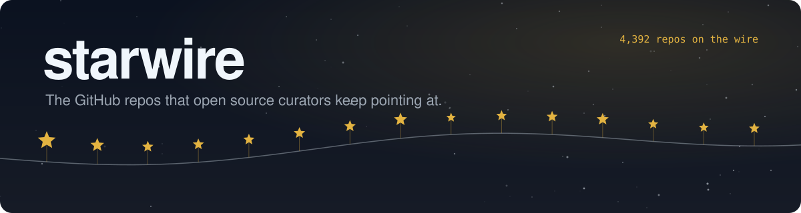

<a href="#-trending">🔥 Trending</a>&nbsp;&nbsp;&nbsp;
<a href="#-new-this-week">🆕 New this week</a>&nbsp;&nbsp;&nbsp;
<a href="#-picked-again-and-again">🔁 Picked again and again</a>&nbsp;&nbsp;&nbsp;
<a href="#-browse-by-area">🗂️ Areas</a>&nbsp;&nbsp;&nbsp;
<a href="#-submit-a-repo">➕ Submit a repo</a>

 

## 🔥 Trending

Gaining stars fastest right now for their size. Stars are counted daily and only measured gains are used. Until a repo has a week of counts, it shows the days measured so far; for repos under 30 days old the missing days use their own average, marked ~.

| Repo | About |
| :-- | :-- |
|  **[xcl](https://github.com/xcl-dev/xcl)** xcl-dev ⭐&nbsp;**8.2k** | Xbox Series compatibility layer that runs console game code on Windows  🎮 Games › Emulators&nbsp;&nbsp;·&nbsp;&nbsp;📈 +8.2k stars a week&nbsp;&nbsp;·&nbsp;&nbsp;🟢 updated today&nbsp;&nbsp;·&nbsp;&nbsp;GPL-2.0&nbsp;&nbsp;·&nbsp;&nbsp;1.1k forks <code>gdk</code> <code>rdna2</code> <code>xbox</code> <code>d3d12</code> |
|  **[Claude-BugHunter](https://github.com/elementalsouls/Claude-BugHunter)** elementalsouls ⭐&nbsp;**22k** | Claude Code skills for bug hunting and external red-team testing   🔐 Security & privacy › Offensive security&nbsp;&nbsp;·&nbsp;&nbsp;📈 +13k stars a week&nbsp;&nbsp;·&nbsp;&nbsp;🟢 updated today&nbsp;&nbsp;·&nbsp;&nbsp;MIT&nbsp;&nbsp;·&nbsp;&nbsp;2.3k forks <code>ai-security</code> <code>anthropic</code> <code>application-security</code> <code>bug-bounty</code> |
|  **[rust-anything](https://github.com/erkamyaman/rust-anything)** erkamyaman ⭐&nbsp;**9.5k** | Agent skill that ports an app to Rust piece by piece with equivalence checks   🛠️ Developer tools › Languages & compilers&nbsp;&nbsp;·&nbsp;&nbsp;📈 +7.9k stars a week&nbsp;&nbsp;·&nbsp;&nbsp;🟢 updated today&nbsp;&nbsp;·&nbsp;&nbsp;MIT&nbsp;&nbsp;·&nbsp;&nbsp;775 forks <code>agent-skills</code> <code>claude-code</code> <code>codex</code> <code>ffi</code> |
|  **[fast-anything](https://github.com/EL4CTEO/fast-anything)** EL4CTEO ⭐&nbsp;**3.8k** | Agent skill that profiles Python, Node or Ruby apps and ports hot paths to Rust  🛠️ Developer tools › Build, packages & runtimes&nbsp;&nbsp;·&nbsp;&nbsp;📈 +3.8k stars a week&nbsp;&nbsp;·&nbsp;&nbsp;🟢 updated 1d ago&nbsp;&nbsp;·&nbsp;&nbsp;MIT&nbsp;&nbsp;·&nbsp;&nbsp;274 forks <code>agent-skills</code> <code>ai-agents</code> <code>claude-code</code> <code>claude-code-plugin</code> |
|  **[xnulinux](https://github.com/AFK-surf/xnulinux)** AFK-surf ⭐&nbsp;**3.8k** | Runs the XNU kernel as a loadable module inside arm64 Linux   💻 System & desktop › System tools&nbsp;&nbsp;·&nbsp;&nbsp;📈 +3.8k stars a week&nbsp;&nbsp;·&nbsp;&nbsp;🟢 updated today&nbsp;&nbsp;·&nbsp;&nbsp;custom license&nbsp;&nbsp;·&nbsp;&nbsp;176 forks |
|  **[t3code](https://github.com/pingdotgg/t3code)** pingdotgg ⭐&nbsp;**79k** | No description yet   🤖 AI & agents › Coding agents&nbsp;&nbsp;·&nbsp;&nbsp;📈 +15k stars a week&nbsp;&nbsp;·&nbsp;&nbsp;🟢 updated today&nbsp;&nbsp;·&nbsp;&nbsp;MIT&nbsp;&nbsp;·&nbsp;&nbsp;14k forks |
|  **[neonclipping](https://github.com/iamajmeena/neonclipping)** iamajmeena ⭐&nbsp;**2.6k** | Local tool that cuts a video link into captioned 9:16 short clips  🎨 Media & design › Video&nbsp;&nbsp;·&nbsp;&nbsp;📈 +2.6k stars a week&nbsp;&nbsp;·&nbsp;&nbsp;🟢 updated 1d ago&nbsp;&nbsp;·&nbsp;&nbsp;AGPL-3.0&nbsp;&nbsp;·&nbsp;&nbsp;162 forks <code>clipping</code> <code>ffmpeg</code> <code>shorts</code> <code>video</code> |
|  **[MROffice](https://github.com/XinaTian/MROffice)** XinaTian ⭐&nbsp;**4.5k** | Browser office suite for documents, sheets, slides and PDFs with AI editing  📝 Productivity › Documents & PDFs&nbsp;&nbsp;·&nbsp;&nbsp;📈 ~+3.3k stars a week&nbsp;&nbsp;·&nbsp;&nbsp;🟢 updated 1d ago&nbsp;&nbsp;·&nbsp;&nbsp;AGPL-3.0&nbsp;&nbsp;·&nbsp;&nbsp;475 forks <code>document-editor</code> <code>excel</code> <code>office-suite</code> <code>pdf-editor</code> |
|  **[Ghost-Downloader-3](https://github.com/XiaoYouChR/Ghost-Downloader-3)** XiaoYouChR ⭐&nbsp;**18k** | Download manager built with PySide6 and Qt, with streaming support   💻 System & desktop › Files & backup&nbsp;&nbsp;·&nbsp;&nbsp;📈 +6.2k stars a week&nbsp;&nbsp;·&nbsp;&nbsp;🟢 updated today&nbsp;&nbsp;·&nbsp;&nbsp;GPL-3.0&nbsp;&nbsp;·&nbsp;&nbsp;1.1k forks <code>downloader</code> <code>pyside6</code> <code>python</code> <code>qt</code> |
|  **[phonebox](https://github.com/ersinkoc/phonebox)** ersinkoc ⭐&nbsp;**6.3k** | Turns an old Android phone into a desk control panel with widgets  💻 System & desktop › System tools&nbsp;&nbsp;·&nbsp;&nbsp;📈 +3.6k stars a week&nbsp;&nbsp;·&nbsp;&nbsp;🟢 updated today&nbsp;&nbsp;·&nbsp;&nbsp;MIT&nbsp;&nbsp;·&nbsp;&nbsp;752 forks <code>android</code> <code>claude-code</code> <code>dotnet</code> <code>stream-deck</code> |
|  **[misterdownloadmanager](https://github.com/anefzaoui/misterdownloadmanager)** anefzaoui ⭐&nbsp;**18k** | Cross-platform download manager written in Rust, an IDM alternative   💻 System & desktop › Files & backup&nbsp;&nbsp;·&nbsp;&nbsp;📈 +5.8k stars a week&nbsp;&nbsp;·&nbsp;&nbsp;🟢 updated today&nbsp;&nbsp;·&nbsp;&nbsp;GPL-3.0&nbsp;&nbsp;·&nbsp;&nbsp;1.5k forks <code>download-accelerator</code> <code>download-manager</code> <code>egui</code> <code>idm-alternative</code> |
|  **[gemini-api-cli](https://github.com/google-gemini/gemini-api-cli)** google-gemini ⭐&nbsp;**2.8k** | Experimental command-line client for the Gemini API  🤖 AI & agents › LLM tooling&nbsp;&nbsp;·&nbsp;&nbsp;📈 +2.3k stars a week&nbsp;&nbsp;·&nbsp;&nbsp;🟢 updated today&nbsp;&nbsp;·&nbsp;&nbsp;Apache-2.0&nbsp;&nbsp;·&nbsp;&nbsp;206 forks <code>gemini</code> <code>gemini-api</code> |
|  **[nospeaker](https://github.com/os6/nospeaker)** os6 ⭐&nbsp;**1.8k** | Makes a MacBook trackpad produce sound with its haptic motor  💻 System & desktop › System tools&nbsp;&nbsp;·&nbsp;&nbsp;📈 +1.8k stars a week&nbsp;&nbsp;·&nbsp;&nbsp;🟢 updated 2d ago&nbsp;&nbsp;·&nbsp;&nbsp;MIT&nbsp;&nbsp;·&nbsp;&nbsp;97 forks <code>haptics</code> <code>macos</code> <code>swift</code> <code>trackpad</code> |
|  **[mobile-agent-testers](https://github.com/pierridotite/mobile-agent-testers)** pierridotite ⭐&nbsp;**2.1k** | Runs parallel Claude Code testers on iOS simulators and Android emulators in CI  🛠️ Developer tools › Testing & debugging&nbsp;&nbsp;·&nbsp;&nbsp;📈 ~+1.9k stars a week&nbsp;&nbsp;·&nbsp;&nbsp;🟢 updated today&nbsp;&nbsp;·&nbsp;&nbsp;MIT&nbsp;&nbsp;·&nbsp;&nbsp;210 forks <code>ai-agents</code> <code>android-emulator</code> <code>claude-code</code> <code>github-actions</code> |
|  **[html-anything](https://github.com/nexu-io/html-anything)** nexu-io ⭐&nbsp;**16k** | Local agent writes HTML for magazines, decks, posters and prototypes  📝 Productivity › Documents & PDFs&nbsp;&nbsp;·&nbsp;&nbsp;📈 +5.1k stars a week&nbsp;&nbsp;·&nbsp;&nbsp;🟢 updated today&nbsp;&nbsp;·&nbsp;&nbsp;Apache-2.0&nbsp;&nbsp;·&nbsp;&nbsp;1.6k forks <code>agent-skills</code> <code>ai-agents</code> <code>ai-design</code> <code>byok</code> |

## 🆕 New this week

105 repos created in the last 90 days and first picked between Nov 18 and Nov 25, most stars first.

| Repo | About |
| :-- | :-- |
|  **[xcl](https://github.com/xcl-dev/xcl)** xcl-dev ⭐&nbsp;**8.2k** | Xbox Series compatibility layer that runs console game code on Windows  🎮 Games › Emulators&nbsp;&nbsp;·&nbsp;&nbsp;📈 +8.2k stars a week&nbsp;&nbsp;·&nbsp;&nbsp;🟢 updated today&nbsp;&nbsp;·&nbsp;&nbsp;GPL-2.0&nbsp;&nbsp;·&nbsp;&nbsp;1.1k forks <code>gdk</code> <code>rdna2</code> <code>xbox</code> <code>d3d12</code> |
|  **[raea](https://github.com/shinyobjectz/raea)** shinyobjectz ⭐&nbsp;**5.1k** | Engine that renders AI-written videos, motion graphics and 3D on your own GPU  🎨 Media & design › Video&nbsp;&nbsp;·&nbsp;&nbsp;🟢 updated today&nbsp;&nbsp;·&nbsp;&nbsp;custom license&nbsp;&nbsp;·&nbsp;&nbsp;410 forks <code>agent-skills</code> <code>bevy</code> <code>claude-code</code> <code>game-engine</code> |
|  **[linger](https://github.com/simplexai-labs/linger)** simplexai-labs ⭐&nbsp;**4.6k** | Proactive personal AI agent that runs fully on your PC   🤖 AI & agents › Agents & automation&nbsp;&nbsp;·&nbsp;&nbsp;📈 ~+2.0k stars a week&nbsp;&nbsp;·&nbsp;&nbsp;🟢 updated today&nbsp;&nbsp;·&nbsp;&nbsp;custom license&nbsp;&nbsp;·&nbsp;&nbsp;430 forks <code>agent-teams</code> <code>local-llm</code> <code>memory</code> <code>personal-agent</code> |
|  **[MROffice](https://github.com/XinaTian/MROffice)** XinaTian ⭐&nbsp;**4.5k** | Browser office suite for documents, sheets, slides and PDFs with AI editing  📝 Productivity › Documents & PDFs&nbsp;&nbsp;·&nbsp;&nbsp;📈 ~+3.3k stars a week&nbsp;&nbsp;·&nbsp;&nbsp;🟢 updated 1d ago&nbsp;&nbsp;·&nbsp;&nbsp;AGPL-3.0&nbsp;&nbsp;·&nbsp;&nbsp;475 forks <code>document-editor</code> <code>excel</code> <code>office-suite</code> <code>pdf-editor</code> |
|  **[fast-anything](https://github.com/EL4CTEO/fast-anything)** EL4CTEO ⭐&nbsp;**3.8k** | Agent skill that profiles Python, Node or Ruby apps and ports hot paths to Rust  🛠️ Developer tools › Build, packages & runtimes&nbsp;&nbsp;·&nbsp;&nbsp;📈 +3.8k stars a week&nbsp;&nbsp;·&nbsp;&nbsp;🟢 updated 1d ago&nbsp;&nbsp;·&nbsp;&nbsp;MIT&nbsp;&nbsp;·&nbsp;&nbsp;274 forks <code>agent-skills</code> <code>ai-agents</code> <code>claude-code</code> <code>claude-code-plugin</code> |
|  **[xnulinux](https://github.com/AFK-surf/xnulinux)** AFK-surf ⭐&nbsp;**3.8k** | Runs the XNU kernel as a loadable module inside arm64 Linux   💻 System & desktop › System tools&nbsp;&nbsp;·&nbsp;&nbsp;📈 +3.8k stars a week&nbsp;&nbsp;·&nbsp;&nbsp;🟢 updated today&nbsp;&nbsp;·&nbsp;&nbsp;custom license&nbsp;&nbsp;·&nbsp;&nbsp;176 forks |
|  **[nod](https://github.com/n8n-io/nod)** n8n-io ⭐&nbsp;**3.4k** | Personal agent with its own computer that handles web chores and asks before acting  🤖 AI & agents › Agents & automation&nbsp;&nbsp;·&nbsp;&nbsp;🟢 updated today&nbsp;&nbsp;·&nbsp;&nbsp;Apache-2.0&nbsp;&nbsp;·&nbsp;&nbsp;558 forks <code>agents</code> <code>ai-agent</code> <code>ai-assistant</code> <code>anthropic</code> |
|  **[quiet-md](https://github.com/s1dashu/quiet-md)** s1dashu ⭐&nbsp;**2.8k** | Native local-first notes app and rich-text editor built with Rust and GPUI  📝 Productivity › Notes & knowledge&nbsp;&nbsp;·&nbsp;&nbsp;📈 ~+813 stars a week&nbsp;&nbsp;·&nbsp;&nbsp;🟢 updated today&nbsp;&nbsp;·&nbsp;&nbsp;MIT&nbsp;&nbsp;·&nbsp;&nbsp;239 forks |
|  **[splash](https://github.com/incoai/splash)** incoai ⭐&nbsp;**2.8k** | Local LLM inference engine for Apple silicon using Metal  🤖 AI & agents › Local models & inference&nbsp;&nbsp;·&nbsp;&nbsp;📈 +100 stars in 2 days&nbsp;&nbsp;·&nbsp;&nbsp;🟢 updated today&nbsp;&nbsp;·&nbsp;&nbsp;Apache-2.0&nbsp;&nbsp;·&nbsp;&nbsp;266 forks <code>apple-silicon</code> <code>coding-agents</code> <code>llm-inference</code> <code>macos</code> |
|  **[neonclipping](https://github.com/iamajmeena/neonclipping)** iamajmeena ⭐&nbsp;**2.6k** | Local tool that cuts a video link into captioned 9:16 short clips  🎨 Media & design › Video&nbsp;&nbsp;·&nbsp;&nbsp;📈 +2.6k stars a week&nbsp;&nbsp;·&nbsp;&nbsp;🟢 updated 1d ago&nbsp;&nbsp;·&nbsp;&nbsp;AGPL-3.0&nbsp;&nbsp;·&nbsp;&nbsp;162 forks <code>clipping</code> <code>ffmpeg</code> <code>shorts</code> <code>video</code> |
|  **[mobile-agent-testers](https://github.com/pierridotite/mobile-agent-testers)** pierridotite ⭐&nbsp;**2.1k** | Runs parallel Claude Code testers on iOS simulators and Android emulators in CI  🛠️ Developer tools › Testing & debugging&nbsp;&nbsp;·&nbsp;&nbsp;📈 ~+1.9k stars a week&nbsp;&nbsp;·&nbsp;&nbsp;🟢 updated today&nbsp;&nbsp;·&nbsp;&nbsp;MIT&nbsp;&nbsp;·&nbsp;&nbsp;210 forks <code>ai-agents</code> <code>android-emulator</code> <code>claude-code</code> <code>github-actions</code> |
|  **[wenxi](https://github.com/z7786/wenxi)** z7786 ⭐&nbsp;**2.1k** | Cross-platform app for parsing and managing files across Chinese cloud drives  💻 System & desktop › Files & backup&nbsp;&nbsp;·&nbsp;&nbsp;📈 +83 stars in 2 days&nbsp;&nbsp;·&nbsp;&nbsp;🟢 updated today&nbsp;&nbsp;·&nbsp;&nbsp;AGPL-3.0&nbsp;&nbsp;·&nbsp;&nbsp;191 forks |
|  **[posewear](https://github.com/atuizz/posewear)** atuizz ⭐&nbsp;**2.1k** | Pose, outfit and portrait reference library with prompts and in-browser AI try-on  🎨 Media & design › Images & graphics&nbsp;&nbsp;·&nbsp;&nbsp;📈 ~+564 stars a week&nbsp;&nbsp;·&nbsp;&nbsp;🟢 updated today&nbsp;&nbsp;·&nbsp;&nbsp;MIT&nbsp;&nbsp;·&nbsp;&nbsp;462 forks <code>ai-art</code> <code>chinese</code> <code>cloudflare-pages</code> <code>gemini</code> |
|  **[basalt](https://github.com/jesdga95/basalt)** jesdga95 ⭐&nbsp;**2.1k** | Local LLM inference engine tuned for NVIDIA Blackwell GPUs  🤖 AI & agents › Local models & inference&nbsp;&nbsp;·&nbsp;&nbsp;📈 +168 stars in 2 days&nbsp;&nbsp;·&nbsp;&nbsp;🟢 updated today&nbsp;&nbsp;·&nbsp;&nbsp;MIT&nbsp;&nbsp;·&nbsp;&nbsp;340 forks |
|  **[nospeaker](https://github.com/os6/nospeaker)** os6 ⭐&nbsp;**1.8k** | Makes a MacBook trackpad produce sound with its haptic motor  💻 System & desktop › System tools&nbsp;&nbsp;·&nbsp;&nbsp;📈 +1.8k stars a week&nbsp;&nbsp;·&nbsp;&nbsp;🟢 updated 2d ago&nbsp;&nbsp;·&nbsp;&nbsp;MIT&nbsp;&nbsp;·&nbsp;&nbsp;97 forks <code>haptics</code> <code>macos</code> <code>swift</code> <code>trackpad</code> |
|  **[Serein](https://github.com/ViceVerse-cz/Serein)** ViceVerse-cz ⭐&nbsp;**1.8k** | Small native Discord client written in Rust  💬 Communication › Chat & messaging&nbsp;&nbsp;·&nbsp;&nbsp;🟢 updated today&nbsp;&nbsp;·&nbsp;&nbsp;Apache-2.0&nbsp;&nbsp;·&nbsp;&nbsp;189 forks |
|  **[hongguoTV](https://github.com/N3urda/hongguoTV)** N3urda ⭐&nbsp;**1.8k** | Android TV client for the Hongguo short drama service  🎨 Media & design › Video&nbsp;&nbsp;·&nbsp;&nbsp;📈 +111 stars in 2 days&nbsp;&nbsp;·&nbsp;&nbsp;🟢 updated today&nbsp;&nbsp;·&nbsp;&nbsp;GPL-3.0&nbsp;&nbsp;·&nbsp;&nbsp;280 forks |
|  **[PixelBoard](https://github.com/Akshayykadam/PixelBoard)** Akshayykadam ⭐&nbsp;**1.7k** | Android keyboard with Gemini voice dictation and AI writing tools  📝 Productivity › Documents & PDFs&nbsp;&nbsp;·&nbsp;&nbsp;🟢 updated 3d ago&nbsp;&nbsp;·&nbsp;&nbsp;GPL-3.0&nbsp;&nbsp;·&nbsp;&nbsp;88 forks <code>ai-writing-tools</code> <code>android</code> <code>apk</code> <code>gboard</code> |
|  **[prism-download-manager](https://github.com/FortoGraphy/prism-download-manager)** FortoGraphy ⭐&nbsp;**1.5k** | Multi-connection download manager with browser integration and torrents  💻 System & desktop › Files & backup&nbsp;&nbsp;·&nbsp;&nbsp;📈 +212 stars in 2 days&nbsp;&nbsp;·&nbsp;&nbsp;🟢 updated 1d ago&nbsp;&nbsp;·&nbsp;&nbsp;MIT&nbsp;&nbsp;·&nbsp;&nbsp;92 forks <code>bittorrent</code> <code>browser-extension</code> <code>cross-platform</code> <code>download-manager</code> |
|  **[echo-dot-assist](https://github.com/Gamer92000/echo-dot-assist)** Gamer92000 ⭐&nbsp;**1.5k** | Firmware turning Amazon Echo Dots into local Home Assistant voice satellites  🦾 Hardware & IoT › Home automation&nbsp;&nbsp;·&nbsp;&nbsp;🟢 updated today&nbsp;&nbsp;·&nbsp;&nbsp;MIT&nbsp;&nbsp;·&nbsp;&nbsp;129 forks <code>assist</code> <code>echo-dot</code> <code>esphome-api</code> <code>home-assistant</code> |

85 more this week, find them in the areas below.

## 🔁 Picked again and again

When several independent sources pick the same repo, it's usually worth a look. 637 repos so far.

| Repo | About |
| :-- | :-- |
|  **[rea](https://github.com/morluto/rea)** morluto ⭐&nbsp;**478k** | Agent-driven reverse engineering from app behavior down to native binaries   🔐 Security & privacy › Reverse engineering&nbsp;&nbsp;·&nbsp;&nbsp;📈 +11k stars a week&nbsp;&nbsp;·&nbsp;&nbsp;🟢 updated today&nbsp;&nbsp;·&nbsp;&nbsp;MIT&nbsp;&nbsp;·&nbsp;&nbsp;116k forks <code>cli</code> <code>mcp</code> <code>agent-skills</code> <code>dsh-plugin</code> |
|  **[AnyPS5](https://github.com/boykopovar/AnyPS5)** boykopovar ⭐&nbsp;**61k** | Tool that automatically ports PS5 executables to run on Linux and Windows   🎮 Games › Emulators&nbsp;&nbsp;·&nbsp;&nbsp;📈 +6.4k stars a week&nbsp;&nbsp;·&nbsp;&nbsp;🟢 updated today&nbsp;&nbsp;·&nbsp;&nbsp;GPL-2.0&nbsp;&nbsp;·&nbsp;&nbsp;6.0k forks <code>dynamic-library</code> <code>game-porting</code> <code>ps5-tools</code> <code>vulkan</code> |
|  **[ECC](https://github.com/affaan-m/ECC)** affaan-m ⭐&nbsp;**311k** | Skills, memory and security rules for tuning coding agent harnesses   🤖 AI & agents › Coding agents&nbsp;&nbsp;·&nbsp;&nbsp;📈 +4.9k stars a week&nbsp;&nbsp;·&nbsp;&nbsp;🟢 updated 3d ago&nbsp;&nbsp;·&nbsp;&nbsp;MIT&nbsp;&nbsp;·&nbsp;&nbsp;46k forks <code>ai-agents</code> <code>anthropic</code> <code>claude</code> <code>claude-code</code> |
|  **[ponytail](https://github.com/DietrichGebert/ponytail)** DietrichGebert ⭐&nbsp;**198k** | Agent skill that pushes AI coding toward minimal, less code   🤖 AI & agents › Coding agents&nbsp;&nbsp;·&nbsp;&nbsp;📈 +5.3k stars a week&nbsp;&nbsp;·&nbsp;&nbsp;🟢 updated 4d ago&nbsp;&nbsp;·&nbsp;&nbsp;MIT&nbsp;&nbsp;·&nbsp;&nbsp;11k forks <code>agent-skills</code> <code>ai-agents</code> <code>claude</code> <code>claude-code</code> |
|  **[open-code-review](https://github.com/alibaba/open-code-review)** alibaba ⭐&nbsp;**56k** | Hybrid code review tool combining rule pipelines with an LLM agent   🛠️ Developer tools › Git & code review&nbsp;&nbsp;·&nbsp;&nbsp;📈 +2.4k stars a week&nbsp;&nbsp;·&nbsp;&nbsp;🟢 updated today&nbsp;&nbsp;·&nbsp;&nbsp;Apache-2.0&nbsp;&nbsp;·&nbsp;&nbsp;4.6k forks <code>agent</code> <code>code-review</code> <code>code-review-assistant</code> <code>harness</code> |
|  **[skills](https://github.com/mattpocock/skills)** mattpocock ⭐&nbsp;**333k** | Collection of agent skills for software engineering, taken from a personal setup   🤖 AI & agents › Coding agents&nbsp;&nbsp;·&nbsp;&nbsp;📈 +5.8k stars a week&nbsp;&nbsp;·&nbsp;&nbsp;🟢 updated today&nbsp;&nbsp;·&nbsp;&nbsp;MIT&nbsp;&nbsp;·&nbsp;&nbsp;28k forks |
|  **[graphify](https://github.com/Graphify-Labs/graphify)** Graphify-Labs ⭐&nbsp;**153k** | Builds a queryable knowledge graph from code, docs and PDFs   🤖 AI & agents › Coding agents&nbsp;&nbsp;·&nbsp;&nbsp;📈 +3.5k stars a week&nbsp;&nbsp;·&nbsp;&nbsp;🟢 updated today&nbsp;&nbsp;·&nbsp;&nbsp;Apache-2.0&nbsp;&nbsp;·&nbsp;&nbsp;15k forks <code>claude-code</code> <code>graphrag</code> <code>knowledge-graph</code> <code>codex</code> |
|  **[MoneyPrinterTurbo](https://github.com/harry0703/MoneyPrinterTurbo)** harry0703 ⭐&nbsp;**146k** | Generates short videos from a topic or keyword using AI and automated editing   🎨 Media & design › Video&nbsp;&nbsp;·&nbsp;&nbsp;📈 +1.4k stars a week&nbsp;&nbsp;·&nbsp;&nbsp;🟢 updated today&nbsp;&nbsp;·&nbsp;&nbsp;MIT&nbsp;&nbsp;·&nbsp;&nbsp;23k forks <code>python</code> <code>tiktok</code> <code>ai-video-generator</code> <code>content-creation</code> |
|  **[immich](https://github.com/immich-app/immich)** immich-app ⭐&nbsp;**120k** | Self-hosted photo and video backup and gallery app   🎨 Media & design › Images & graphics&nbsp;&nbsp;·&nbsp;&nbsp;📈 +589 stars a week&nbsp;&nbsp;·&nbsp;&nbsp;🟢 updated today&nbsp;&nbsp;·&nbsp;&nbsp;AGPL-3.0&nbsp;&nbsp;·&nbsp;&nbsp;7.7k forks <code>backup-tool</code> <code>mobile-app</code> <code>photo-gallery</code> <code>photos</code> |
|  **[localsend](https://github.com/localsend/localsend)** localsend ⭐&nbsp;**101k** | Cross-platform app for sending files to nearby devices over the local network   💻 System & desktop › Files & backup&nbsp;&nbsp;·&nbsp;&nbsp;📈 +1.3k stars a week&nbsp;&nbsp;·&nbsp;&nbsp;🟢 updated 1d ago&nbsp;&nbsp;·&nbsp;&nbsp;Apache-2.0&nbsp;&nbsp;·&nbsp;&nbsp;5.8k forks <code>flutter</code> <code>file-sharing</code> <code>dart</code> <code>flutter-apps</code> |
|  **[OpenCut](https://github.com/OpenCut-app/OpenCut)** OpenCut-app ⭐&nbsp;**99k** | Open-source video editor with a timeline, as a free alternative to CapCut   🎨 Media & design › Video&nbsp;&nbsp;·&nbsp;&nbsp;📈 +572 stars a week&nbsp;&nbsp;·&nbsp;&nbsp;🟡 updated 2mo ago&nbsp;&nbsp;·&nbsp;&nbsp;MIT&nbsp;&nbsp;·&nbsp;&nbsp;9.9k forks <code>editor</code> <code>oss</code> <code>videoeditor</code> |
|  **[OpenMontage](https://github.com/calesthio/OpenMontage)** calesthio ⭐&nbsp;**83k** | Agentic video production pipelines and tools for AI coding assistants   🎨 Media & design › Video&nbsp;&nbsp;·&nbsp;&nbsp;📈 +1.9k stars a week&nbsp;&nbsp;·&nbsp;&nbsp;🟢 updated 10d ago&nbsp;&nbsp;·&nbsp;&nbsp;AGPL-3.0&nbsp;&nbsp;·&nbsp;&nbsp;11k forks <code>agent</code> <code>agentic-ai</code> <code>ai</code> <code>claude</code> |
|  **[headroom](https://github.com/headroomlabs-ai/headroom)** headroomlabs-ai ⭐&nbsp;**81k** | Compresses tool outputs and RAG chunks before they reach the LLM as a library, proxy, or MCP server   🤖 AI & agents › LLM tooling&nbsp;&nbsp;·&nbsp;&nbsp;📈 +903 stars a week&nbsp;&nbsp;·&nbsp;&nbsp;🟢 updated today&nbsp;&nbsp;·&nbsp;&nbsp;Apache-2.0&nbsp;&nbsp;·&nbsp;&nbsp;6.3k forks <code>agent</code> <code>ai</code> <code>anthropic</code> <code>compression</code> |
|  **[diagram-design](https://github.com/cathrynlavery/diagram-design)** cathrynlavery ⭐&nbsp;**73k** | Skill that makes self-contained HTML and SVG diagrams in 45 styles   🎨 Media & design › Images & graphics&nbsp;&nbsp;·&nbsp;&nbsp;📈 +4.7k stars a week&nbsp;&nbsp;·&nbsp;&nbsp;🟢 updated today&nbsp;&nbsp;·&nbsp;&nbsp;MIT&nbsp;&nbsp;·&nbsp;&nbsp;4.8k forks <code>agent-skills</code> <code>claude-code</code> <code>codex</code> <code>data-visualization</code> |
|  **[gods-eye-view](https://github.com/bilawalsidhu/gods-eye-view)** bilawalsidhu ⭐&nbsp;**67k** | Browser-based 3D globe showing live flight and geospatial data   🔬 Science & research › Maps & GIS&nbsp;&nbsp;·&nbsp;&nbsp;📈 +1.1k stars a week&nbsp;&nbsp;·&nbsp;&nbsp;🟢 updated today&nbsp;&nbsp;·&nbsp;&nbsp;custom license&nbsp;&nbsp;·&nbsp;&nbsp;13k forks <code>3d-globe</code> <code>cesium</code> <code>flight-tracking</code> <code>geospatial</code> |

## 🗂 Browse by area

A repo can sit in more than one area. On [starwire.foo](https://starwire.foo) you can also filter by subarea, form, platform and the tools it works with.

<table>
<tr><td valign="top" width="33%">

### 🤖 [AI & agents](lists/ai-agents.md)
1445 repos <a href="https://github.com/morluto/rea">rea</a>, <a href="https://github.com/openclaw/openclaw">openclaw</a>, <a href="https://github.com/mattpocock/skills">skills</a>

</td><td valign="top" width="33%">

### 🛠️ [Developer tools](lists/developer-tools.md)
584 repos <a href="https://github.com/anomalyco/opencode">opencode</a>, <a href="https://github.com/microsoft/vscode">vscode</a>, <a href="https://github.com/flutter/flutter">flutter</a>

</td><td valign="top" width="33%">

### 🌐 [Web & frontend](lists/web-frontend.md)
262 repos <a href="https://github.com/react/react">react</a>, <a href="https://github.com/flutter/flutter">flutter</a>, <a href="https://github.com/nextlevelbuilder/ui-ux-pro-max-skill">ui-ux-pro-max-skill</a>

</td></tr>
<tr><td valign="top" width="33%">

### ☁️ [Infrastructure & DevOps](lists/infrastructure-devops.md)
264 repos <a href="https://github.com/clash-verge-rev/clash-verge-rev">clash-verge-rev</a>, <a href="https://github.com/ripienaar/free-for-dev">free-for-dev</a>, <a href="https://github.com/kubernetes/kubernetes">kubernetes</a>

</td><td valign="top" width="33%">

### 🗄️ [Data](lists/data.md)
259 repos <a href="https://github.com/firecrawl/firecrawl">firecrawl</a>, <a href="https://github.com/supabase/supabase">supabase</a>, <a href="https://github.com/Panniantong/Agent-Reach">Agent-Reach</a>

</td><td valign="top" width="33%">

### 🔐 [Security & privacy](lists/security-privacy.md)
285 repos <a href="https://github.com/morluto/rea">rea</a>, <a href="https://github.com/2dust/v2rayN">v2rayN</a>, <a href="https://github.com/sherlock-project/sherlock">sherlock</a>

</td></tr>
<tr><td valign="top" width="33%">

### 📝 [Productivity](lists/productivity.md)
313 repos <a href="https://github.com/langflow-ai/langflow">langflow</a>, <a href="https://github.com/excalidraw/excalidraw">excalidraw</a>, <a href="https://github.com/Stirling-Tools/Stirling-PDF">Stirling-PDF</a>

</td><td valign="top" width="33%">

### 🎨 [Media & design](lists/media-design.md)
512 repos <a href="https://github.com/yt-dlp/yt-dlp">yt-dlp</a>, <a href="https://github.com/harry0703/MoneyPrinterTurbo">MoneyPrinterTurbo</a>, <a href="https://github.com/iptv-org/iptv">iptv</a>

</td><td valign="top" width="33%">

### 💬 [Communication](lists/communication.md)
105 repos <a href="https://github.com/rustdesk/rustdesk">rustdesk</a>, <a href="https://github.com/mastodon/mastodon">mastodon</a>, <a href="https://github.com/discourse/discourse">discourse</a>

</td></tr>
<tr><td valign="top" width="33%">

### 🎮 [Games](lists/games.md)
202 repos <a href="https://github.com/godotengine/godot">godot</a>, <a href="https://github.com/boykopovar/AnyPS5">AnyPS5</a>, <a href="https://github.com/SunshineStream/Sunshine">Sunshine</a>

</td><td valign="top" width="33%">

### 🦾 [Hardware & IoT](lists/hardware-iot.md)
249 repos <a href="https://github.com/ruvnet/RuView">RuView</a>, <a href="https://github.com/home-assistant/core">core</a>, <a href="https://github.com/commaai/openpilot">openpilot</a>

</td><td valign="top" width="33%">

### 💻 [System & desktop](lists/system-desktop.md)
368 repos <a href="https://github.com/torvalds/linux">linux</a>, <a href="https://github.com/Genymobile/scrcpy">scrcpy</a>, <a href="https://github.com/microsoft/PowerToys">PowerToys</a>

</td></tr>
<tr><td valign="top" width="33%">

### 🔬 [Science & research](lists/science-research.md)
154 repos <a href="https://github.com/koala73/worldmonitor">worldmonitor</a>, <a href="https://github.com/666ghj/MiroFish">MiroFish</a>, <a href="https://github.com/bilawalsidhu/gods-eye-view">gods-eye-view</a>

</td><td valign="top" width="33%">

### 💰 [Finance & business](lists/finance-business.md)
123 repos <a href="https://github.com/TauricResearch/TradingAgents">TradingAgents</a>, <a href="https://github.com/openbq-org/OpenBB">OpenBB</a>, <a href="https://github.com/ZhuLinsen/daily_stock_analysis">daily_stock_analysis</a>

</td><td valign="top" width="33%">

### 📚 [Learning & reference](lists/learning-reference.md)
198 repos <a href="https://github.com/codecrafters-io/build-your-own-x">build-your-own-x</a>, <a href="https://github.com/sindresorhus/awesome">awesome</a>, <a href="https://github.com/practical-tutorials/project-based-learning">project-based-learning</a>

</td></tr>
</table>

<b>Legend</b>

 

| | |
| :-- | :-- |
| 🟢 / 🟡 / ⚪ | Code pushed in the last month / the last year / longer ago |
|  | Number of independent sources that picked it |
| <code>topic</code> | GitHub topics set by the repo's owner |

## ➕ Submit a repo

Know a repo that belongs here? [Open a submission](https://github.com/boffti/starwire/issues/new?template=submit-repo.yml) with its link. It gets checked on the next update, usually within two days, and the issue is closed with the result. Your own projects are welcome too, just say so in the form.

## 📡 Use the data

- [`data/repos.json`](data/repos.json): every repo with stars, language, license, topics, area, subarea and when it was first picked.
- [Weekly email](https://list.starwire.foo/subscription/form): the repo of the week, what is trending and what is new, once a week. Sign up there or from the Newsletter button on starwire.foo.
- [`starwire.foo/top.xml`](https://starwire.foo/top.xml): RSS feed with one item a day, the repos rising fastest and the biggest new picks.
- [`starwire.foo/feed.xml`](https://starwire.foo/feed.xml): RSS feed of the 100 newest picks. Add it to any feed reader. [StarDash](https://github.com/boffti/stardash), a free and open source dashboard for your GitHub stars that you host yourself, reads it as a Radar source.

## 📄 License

The list (this README, `lists/`, `data/` and the feed) is [CC0 1.0](LICENSE): use it for anything, no credit needed. The site code in `docs/` is [MIT](docs/LICENSE). How picks are found, checked and ranked: [starwire.foo/how.html](https://starwire.foo/how.html). Want to help? See [CONTRIBUTING.md](CONTRIBUTING.md).

