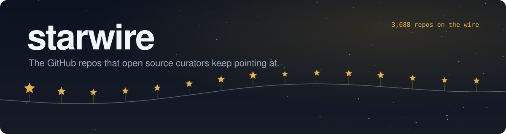

<a href="#-trending">🔥 Trending</a>&nbsp;&nbsp;&nbsp;
<a href="#-new-this-week">🆕 New this week</a>&nbsp;&nbsp;&nbsp;
<a href="#-picked-again-and-again">🔁 Picked again and again</a>&nbsp;&nbsp;&nbsp;
<a href="#-browse-by-area">🗂️ Areas</a>&nbsp;&nbsp;&nbsp;
<a href="#-submit-a-repo">➕ Submit a repo</a>

 

## 🔥 Trending

Gaining stars fastest right now for their size. Stars are counted daily and only measured gains are used. Until a repo has a week of counts, it shows the days measured so far; for repos under 30 days old the missing days use their own average, marked ~.

| Repo | About |
| :-- | :-- |
|  **[craft-anything](https://github.com/storytold/craft-anything)** storytold ⭐&nbsp;**31k** | Tool for learning how software works by crafting your own version   📚 Learning & reference › Courses & tutorials&nbsp;&nbsp;·&nbsp;&nbsp;📈 +16k stars a week&nbsp;&nbsp;·&nbsp;&nbsp;🟢 updated 1d ago&nbsp;&nbsp;·&nbsp;&nbsp;Apache-2.0&nbsp;&nbsp;·&nbsp;&nbsp;6.3k forks |
|  **[astryx](https://github.com/meta/astryx)** meta ⭐&nbsp;**27k** | Customizable design system built to be used by coding agents   🌐 Web & frontend › UI components & design systems&nbsp;&nbsp;·&nbsp;&nbsp;📈 +13k stars a week&nbsp;&nbsp;·&nbsp;&nbsp;🟢 updated today&nbsp;&nbsp;·&nbsp;&nbsp;MIT&nbsp;&nbsp;·&nbsp;&nbsp;2.1k forks |
|  **[misterdownloadmanager](https://github.com/anefzaoui/misterdownloadmanager)** anefzaoui ⭐&nbsp;**8.5k** | Cross-platform download manager written in Rust, an IDM alternative  💻 System & desktop › Files & backup&nbsp;&nbsp;·&nbsp;&nbsp;📈 ~+7.2k stars a week&nbsp;&nbsp;·&nbsp;&nbsp;🟢 updated today&nbsp;&nbsp;·&nbsp;&nbsp;GPL-3.0&nbsp;&nbsp;·&nbsp;&nbsp;698 forks <code>download-accelerator</code> <code>download-manager</code> <code>egui</code> <code>idm-alternative</code> |
|  **[dsh-superagent-prototype](https://github.com/deepseek-ai/dsh-superagent-prototype)** deepseek-ai ⭐&nbsp;**23k** | Prototype of a more autonomous agent system from DeepSeek  🤖 AI & agents › Agents & automation&nbsp;&nbsp;·&nbsp;&nbsp;📈 ~+9.3k stars a week&nbsp;&nbsp;·&nbsp;&nbsp;🟢 updated 11d ago&nbsp;&nbsp;·&nbsp;&nbsp;MIT&nbsp;&nbsp;·&nbsp;&nbsp;2.8k forks |
|  **[OpenMausBot](https://github.com/milind-soni/OpenMausBot)** milind-soni ⭐&nbsp;**22k** | Open-source Grok Bot alternative where bots run inside a virtual machine   🤖 AI & agents › Agents & automation&nbsp;&nbsp;·&nbsp;&nbsp;📈 +8.4k stars a week&nbsp;&nbsp;·&nbsp;&nbsp;🟢 updated today&nbsp;&nbsp;·&nbsp;&nbsp;Apache-2.0&nbsp;&nbsp;·&nbsp;&nbsp;3.0k forks <code>ai-agents</code> <code>claude-code</code> <code>codex</code> <code>computer-use</code> |
|  **[rea-video](https://github.com/JuneYaooo/rea-video)** JuneYaooo ⭐&nbsp;**7.8k** | Agent skill that breaks a video into shots and explains how to remake it   🎨 Media & design › Video&nbsp;&nbsp;·&nbsp;&nbsp;📈 ~+4.8k stars a week&nbsp;&nbsp;·&nbsp;&nbsp;🟢 updated today&nbsp;&nbsp;·&nbsp;&nbsp;Apache-2.0&nbsp;&nbsp;·&nbsp;&nbsp;1.1k forks <code>agent-skills</code> <code>ai-video</code> <code>aigc-detection</code> <code>claude-code</code> |
|  **[rune](https://github.com/anomalyco/rune)** anomalyco ⭐&nbsp;**7.0k** | GPU-rendered native UI framework in Rust for desktop and the web  🌐 Web & frontend › UI components & design systems&nbsp;&nbsp;·&nbsp;&nbsp;📈 ~+4.2k stars a week&nbsp;&nbsp;·&nbsp;&nbsp;🟢 updated today&nbsp;&nbsp;·&nbsp;&nbsp;MIT&nbsp;&nbsp;·&nbsp;&nbsp;260 forks |
|  **[modern-web-guidance](https://github.com/GoogleChrome/modern-web-guidance)** GoogleChrome ⭐&nbsp;**9.5k** | Current web best practices packaged as guidance for coding agents  🌐 Web & frontend › Frameworks&nbsp;&nbsp;·&nbsp;&nbsp;📈 +4.7k stars in 2 days&nbsp;&nbsp;·&nbsp;&nbsp;🟢 updated 4d ago&nbsp;&nbsp;·&nbsp;&nbsp;Apache-2.0&nbsp;&nbsp;·&nbsp;&nbsp;324 forks |
|  **[unslop](https://github.com/heydamir/unslop)** heydamir ⭐&nbsp;**15k** | Claude skill that redesigns AI looking UI into a more deliberate interface   🌐 Web & frontend › UI components & design systems&nbsp;&nbsp;·&nbsp;&nbsp;📈 +5.5k stars a week&nbsp;&nbsp;·&nbsp;&nbsp;🟢 updated 5d ago&nbsp;&nbsp;·&nbsp;&nbsp;CC-BY-4.0&nbsp;&nbsp;·&nbsp;&nbsp;884 forks |
|  **[t3code](https://github.com/pingdotgg/t3code)** pingdotgg ⭐&nbsp;**59k** | No description yet   🤖 AI & agents › Coding agents&nbsp;&nbsp;·&nbsp;&nbsp;📈 +11k stars a week&nbsp;&nbsp;·&nbsp;&nbsp;🟢 updated today&nbsp;&nbsp;·&nbsp;&nbsp;MIT&nbsp;&nbsp;·&nbsp;&nbsp;11k forks |
|  **[auto-ontology](https://github.com/NVIDIA/auto-ontology)** NVIDIA ⭐&nbsp;**12k** | Builds graph-based semantic layers over data for query generation and retrieval   🤖 AI & agents › LLM tooling&nbsp;&nbsp;·&nbsp;&nbsp;📈 +4.9k stars a week&nbsp;&nbsp;·&nbsp;&nbsp;🟢 updated today&nbsp;&nbsp;·&nbsp;&nbsp;Apache-2.0&nbsp;&nbsp;·&nbsp;&nbsp;1.0k forks |
|  **[exact](https://github.com/expo/exact)** expo ⭐&nbsp;**3.7k** | Write one app that runs natively on web, macOS, iOS and Linux  🛠️ Developer tools › Build, packages & runtimes&nbsp;&nbsp;·&nbsp;&nbsp;📈 ~+2.6k stars a week&nbsp;&nbsp;·&nbsp;&nbsp;🟢 updated today&nbsp;&nbsp;·&nbsp;&nbsp;MIT&nbsp;&nbsp;·&nbsp;&nbsp;89 forks <code>ai-agents</code> <code>appkit</code> <code>coding-agents</code> <code>cross-platform</code> |
|  **[bla](https://github.com/qybaihe/bla)** qybaihe ⭐&nbsp;**5.5k** | Defense that poisons binaries and bundles to slow AI reverse-engineering agents  🔐 Security & privacy › Reverse engineering&nbsp;&nbsp;·&nbsp;&nbsp;📈 +3.1k stars a week&nbsp;&nbsp;·&nbsp;&nbsp;🟢 updated today&nbsp;&nbsp;·&nbsp;&nbsp;MIT&nbsp;&nbsp;·&nbsp;&nbsp;671 forks <code>adversarial-ai</code> <code>claude-code</code> <code>cursor</code> <code>electron-security</code> |
|  **[agent-desktop](https://github.com/vercel-labs/agent-desktop)** vercel-labs ⭐&nbsp;**23k** | CLI for AI agents to control desktop apps through accessibility APIs   🤖 AI & agents › Agents & automation&nbsp;&nbsp;·&nbsp;&nbsp;📈 +6.0k stars a week&nbsp;&nbsp;·&nbsp;&nbsp;🟢 updated today&nbsp;&nbsp;·&nbsp;&nbsp;Apache-2.0&nbsp;&nbsp;·&nbsp;&nbsp;1.7k forks <code>accessibility</code> <code>accessibility-api</code> <code>ai-agents</code> <code>automation</code> |
|  **[security-audit-skill](https://github.com/cloudflare/security-audit-skill)** cloudflare ⭐&nbsp;**72k** | Agent skill for multi-phase security audits with machine-readable findings   🔐 Security & privacy › Defense & monitoring&nbsp;&nbsp;·&nbsp;&nbsp;📈 +9.8k stars a week&nbsp;&nbsp;·&nbsp;&nbsp;🟡 updated 2mo ago&nbsp;&nbsp;·&nbsp;&nbsp;MIT&nbsp;&nbsp;·&nbsp;&nbsp;4.8k forks |

## 🆕 New this week

86 repos created in the last 90 days and first picked between Nov 6 and Nov 13, most stars first.

| Repo | About |
| :-- | :-- |
|  **[dsh-superagent-prototype](https://github.com/deepseek-ai/dsh-superagent-prototype)** deepseek-ai ⭐&nbsp;**23k** | Prototype of a more autonomous agent system from DeepSeek  🤖 AI & agents › Agents & automation&nbsp;&nbsp;·&nbsp;&nbsp;📈 ~+9.3k stars a week&nbsp;&nbsp;·&nbsp;&nbsp;🟢 updated 11d ago&nbsp;&nbsp;·&nbsp;&nbsp;MIT&nbsp;&nbsp;·&nbsp;&nbsp;2.8k forks |
|  **[replica-skill](https://github.com/Jakeschincariol/replica-skill)** Jakeschincariol ⭐&nbsp;**9.2k** | Eleven Claude skills that reverse-engineer, rebuild and test an existing app   🤖 AI & agents › Coding agents&nbsp;&nbsp;·&nbsp;&nbsp;📈 +247 stars in 2 days&nbsp;&nbsp;·&nbsp;&nbsp;🟡 updated 1mo ago&nbsp;&nbsp;·&nbsp;&nbsp;MIT&nbsp;&nbsp;·&nbsp;&nbsp;1.7k forks <code>agent</code> <code>agent-skills</code> <code>app-clone</code> <code>claude</code> |
|  **[misterdownloadmanager](https://github.com/anefzaoui/misterdownloadmanager)** anefzaoui ⭐&nbsp;**8.5k** | Cross-platform download manager written in Rust, an IDM alternative  💻 System & desktop › Files & backup&nbsp;&nbsp;·&nbsp;&nbsp;📈 ~+7.2k stars a week&nbsp;&nbsp;·&nbsp;&nbsp;🟢 updated today&nbsp;&nbsp;·&nbsp;&nbsp;GPL-3.0&nbsp;&nbsp;·&nbsp;&nbsp;698 forks <code>download-accelerator</code> <code>download-manager</code> <code>egui</code> <code>idm-alternative</code> |
|  **[NX2Apple](https://github.com/LNPANDY/NX2Apple)** LNPANDY ⭐&nbsp;**6.7k** | macOS app that packages your own Switch games to run on iPhone and iPad  🎮 Games › Emulators&nbsp;&nbsp;·&nbsp;&nbsp;📈 ~+2.0k stars a week&nbsp;&nbsp;·&nbsp;&nbsp;🟢 updated today&nbsp;&nbsp;·&nbsp;&nbsp;MIT&nbsp;&nbsp;·&nbsp;&nbsp;830 forks <code>custom-format</code> <code>homebrew</code> <code>ios</code> <code>ipad</code> |
|  **[aws-emulator](https://github.com/aws/aws-emulator)** aws ⭐&nbsp;**6.3k** | Local emulator of the AWS APIs  ☁️ Infrastructure & DevOps › Servers & hosting&nbsp;&nbsp;·&nbsp;&nbsp;🟢 updated today&nbsp;&nbsp;·&nbsp;&nbsp;CC0-1.0&nbsp;&nbsp;·&nbsp;&nbsp;234 forks |
|  **[TokenEconomizer](https://github.com/microsoft/TokenEconomizer)** microsoft ⭐&nbsp;**6.0k** | Cuts token costs of coding agents using past run experience  🤖 AI & agents › Coding agents&nbsp;&nbsp;·&nbsp;&nbsp;📈 +1.1k stars in 6 days&nbsp;&nbsp;·&nbsp;&nbsp;🟢 updated 1d ago&nbsp;&nbsp;·&nbsp;&nbsp;Apache-2.0&nbsp;&nbsp;·&nbsp;&nbsp;379 forks <code>agentic-ai</code> <code>agentic-coding</code> <code>ai-coding</code> <code>ai-coding-assistant</code> |
|  **[YunX-Desktop](https://github.com/tidain/YunX-Desktop)** tidain ⭐&nbsp;**5.5k** | Windows desktop app that resolves cloud drive and video links for download  💻 System & desktop › Files & backup&nbsp;&nbsp;·&nbsp;&nbsp;🟢 updated today&nbsp;&nbsp;·&nbsp;&nbsp;AGPL-3.0&nbsp;&nbsp;·&nbsp;&nbsp;430 forks |
|  **[zapfast](https://github.com/crmne/zapfast)** crmne ⭐&nbsp;**4.3k** | Native WhatsApp desktop client built with Rust and egui   💬 Communication › Chat & messaging&nbsp;&nbsp;·&nbsp;&nbsp;📈 +1.0k stars in 6 days&nbsp;&nbsp;·&nbsp;&nbsp;🟢 updated 3d ago&nbsp;&nbsp;·&nbsp;&nbsp;MIT&nbsp;&nbsp;·&nbsp;&nbsp;423 forks <code>chat</code> <code>desktop-app</code> <code>egui</code> <code>linux</code> |
|  **[exact](https://github.com/expo/exact)** expo ⭐&nbsp;**3.7k** | Write one app that runs natively on web, macOS, iOS and Linux  🛠️ Developer tools › Build, packages & runtimes&nbsp;&nbsp;·&nbsp;&nbsp;📈 ~+2.6k stars a week&nbsp;&nbsp;·&nbsp;&nbsp;🟢 updated today&nbsp;&nbsp;·&nbsp;&nbsp;MIT&nbsp;&nbsp;·&nbsp;&nbsp;89 forks <code>ai-agents</code> <code>appkit</code> <code>coding-agents</code> <code>cross-platform</code> |
|  **[Awesome-REA](https://github.com/reacher-z/Awesome-REA)** reacher-z ⭐&nbsp;**2.7k** | Curated tools, case studies and papers for reverse engineering  🔐 Security & privacy › Reverse engineering&nbsp;&nbsp;·&nbsp;&nbsp;📈 ~+616 stars a week&nbsp;&nbsp;·&nbsp;&nbsp;🟢 updated today&nbsp;&nbsp;·&nbsp;&nbsp;MIT&nbsp;&nbsp;·&nbsp;&nbsp;476 forks <code>agent-skills</code> <code>ai-agents</code> <code>awesome-list</code> <code>ghidra</code> |
|  **[MFG-Unlocker](https://github.com/dashdogy/MFG-Unlocker)** dashdogy ⭐&nbsp;**2.5k** | Unlocks and controls DLSS Multi Frame Generation on RTX GPUs  🎮 Games › Games&nbsp;&nbsp;·&nbsp;&nbsp;🟢 updated 1d ago&nbsp;&nbsp;·&nbsp;&nbsp;MIT&nbsp;&nbsp;·&nbsp;&nbsp;79 forks |
|  **[BRUTAL](https://github.com/ahwootech/BRUTAL)** ahwootech ⭐&nbsp;**2.5k** | C# framework for games and game engines with direct Vulkan access  🎮 Games › Game engines & dev&nbsp;&nbsp;·&nbsp;&nbsp;📈 ~+434 stars a week&nbsp;&nbsp;·&nbsp;&nbsp;🟢 updated 2d ago&nbsp;&nbsp;·&nbsp;&nbsp;custom license&nbsp;&nbsp;·&nbsp;&nbsp;165 forks <code>csharp</code> <code>dotnet</code> <code>game-engine</code> <code>vulkan</code> |
|  **[BrowserKitten](https://github.com/Player-YN/BrowserKitten)** Player-YN ⭐&nbsp;**2.4k** | Chrome side-panel agent that reads pages and acts, bring your own model  🤖 AI & agents › Agents & automation&nbsp;&nbsp;·&nbsp;&nbsp;🟢 updated 8d ago&nbsp;&nbsp;·&nbsp;&nbsp;MIT <code>ai-agent</code> <code>browser-agent</code> <code>chrome-extension</code> <code>llm</code> |
|  **[Agent2API](https://github.com/aimod-cc/Agent2API)** aimod-cc ⭐&nbsp;**2.2k** | Local gateway that exposes AI coding clients as OpenAI and Anthropic APIs  🤖 AI & agents › LLM tooling&nbsp;&nbsp;·&nbsp;&nbsp;🟢 updated 4d ago&nbsp;&nbsp;·&nbsp;&nbsp;AGPL-3.0&nbsp;&nbsp;·&nbsp;&nbsp;586 forks <code>autoclaw</code> <code>catpaw</code> <code>local-proxy</code> <code>openai-compatible</code> |
|  **[ram-altman](https://github.com/IainKay/ram-altman)** IainKay ⭐&nbsp;**2.1k** | Joke cron script that emails your unused RAM to the CEO of OpenAI  💻 System & desktop › System tools&nbsp;&nbsp;·&nbsp;&nbsp;📈 ~+1.4k stars a week&nbsp;&nbsp;·&nbsp;&nbsp;🟢 updated 7d ago&nbsp;&nbsp;·&nbsp;&nbsp;Unlicense&nbsp;&nbsp;·&nbsp;&nbsp;63 forks <code>bash</code> <code>cron</code> <code>dram</code> <code>email</code> |
|  **[indra](https://github.com/datalab-to/indra)** datalab-to ⭐&nbsp;**1.8k** | 1M-parameter OCR model that runs on CPU  🤖 AI & agents › Local models & inference&nbsp;&nbsp;·&nbsp;&nbsp;🟢 updated 9d ago&nbsp;&nbsp;·&nbsp;&nbsp;Apache-2.0&nbsp;&nbsp;·&nbsp;&nbsp;182 forks <code>ai</code> <code>cpu</code> <code>document-parsing</code> <code>ocr</code> |
|  **[Stela](https://github.com/tylertms/Stela)** tylertms ⭐&nbsp;**1.7k** | Translation layer for running Apple Silicon software on x86-64 PCs  💻 System & desktop › System tools&nbsp;&nbsp;·&nbsp;&nbsp;🟢 updated today&nbsp;&nbsp;·&nbsp;&nbsp;GPL-2.0&nbsp;&nbsp;·&nbsp;&nbsp;88 forks |
|  **[vork](https://github.com/voyager-so/vork)** voyager-so ⭐&nbsp;**1.5k** | Headless 3D and VFX rendering engine for agents  🤖 AI & agents › Agents & automation&nbsp;&nbsp;·&nbsp;&nbsp;📈 ~+836 stars a week&nbsp;&nbsp;·&nbsp;&nbsp;🟢 updated 2d ago&nbsp;&nbsp;·&nbsp;&nbsp;custom license&nbsp;&nbsp;·&nbsp;&nbsp;126 forks <code>3d</code> <code>ai-agents</code> <code>gpu</code> <code>metal</code> |
|  **[Veyra-NRVideo](https://github.com/Likely7/Veyra-NRVideo)** Likely7 ⭐&nbsp;**1.4k** | Windows video player and capture tool with AI upscaling and frame generation  🎨 Media & design › Video&nbsp;&nbsp;·&nbsp;&nbsp;🟢 updated 2d ago&nbsp;&nbsp;·&nbsp;&nbsp;GPL-3.0&nbsp;&nbsp;·&nbsp;&nbsp;65 forks |
|  **[novel-sound](https://github.com/ch6vip/novel-sound)** ch6vip ⭐&nbsp;**1.4k** | Android reader for novels, comics, audiobooks and short dramas  📝 Productivity › Reading & bookmarks&nbsp;&nbsp;·&nbsp;&nbsp;🟢 updated today&nbsp;&nbsp;·&nbsp;&nbsp;GPL-3.0&nbsp;&nbsp;·&nbsp;&nbsp;221 forks <code>android</code> <code>audiobook</code> <code>dart</code> <code>flutter</code> |

66 more this week, find them in the areas below.

## 🔁 Picked again and again

When several independent sources pick the same repo, it's usually worth a look. 529 repos so far.

| Repo | About |
| :-- | :-- |
|  **[rea](https://github.com/morluto/rea)** morluto ⭐&nbsp;**457k** | Agent-driven reverse engineering from app behavior down to native binaries   🔐 Security & privacy › Reverse engineering&nbsp;&nbsp;·&nbsp;&nbsp;📈 +22k stars a week&nbsp;&nbsp;·&nbsp;&nbsp;🟢 updated today&nbsp;&nbsp;·&nbsp;&nbsp;MIT&nbsp;&nbsp;·&nbsp;&nbsp;112k forks <code>cli</code> <code>mcp</code> <code>agent-skills</code> <code>dsh-plugin</code> |
|  **[ECC](https://github.com/affaan-m/ECC)** affaan-m ⭐&nbsp;**302k** | Skills, memory and security rules for tuning coding agent harnesses   🤖 AI & agents › Coding agents&nbsp;&nbsp;·&nbsp;&nbsp;📈 +4.3k stars a week&nbsp;&nbsp;·&nbsp;&nbsp;🟢 updated 5d ago&nbsp;&nbsp;·&nbsp;&nbsp;MIT&nbsp;&nbsp;·&nbsp;&nbsp;45k forks <code>ai-agents</code> <code>anthropic</code> <code>claude</code> <code>claude-code</code> |
|  **[ponytail](https://github.com/DietrichGebert/ponytail)** DietrichGebert ⭐&nbsp;**190k** | Agent skill that pushes AI coding toward minimal, less code   🤖 AI & agents › Coding agents&nbsp;&nbsp;·&nbsp;&nbsp;📈 +4.8k stars a week&nbsp;&nbsp;·&nbsp;&nbsp;🟢 updated 16d ago&nbsp;&nbsp;·&nbsp;&nbsp;MIT&nbsp;&nbsp;·&nbsp;&nbsp;11k forks <code>agent-skills</code> <code>ai-agents</code> <code>claude</code> <code>claude-code</code> |
|  **[AnyPS5](https://github.com/boykopovar/AnyPS5)** boykopovar ⭐&nbsp;**54k** | Tool that automatically ports PS5 executables to run on Linux and Windows   🎮 Games › Emulators&nbsp;&nbsp;·&nbsp;&nbsp;📈 +2.1k stars a week&nbsp;&nbsp;·&nbsp;&nbsp;🟢 updated today&nbsp;&nbsp;·&nbsp;&nbsp;GPL-2.0&nbsp;&nbsp;·&nbsp;&nbsp;5.1k forks <code>dynamic-library</code> <code>game-porting</code> <code>ps5-tools</code> <code>vulkan</code> |
|  **[skills](https://github.com/mattpocock/skills)** mattpocock ⭐&nbsp;**323k** | Collection of agent skills for software engineering, taken from a personal setup   🤖 AI & agents › Coding agents&nbsp;&nbsp;·&nbsp;&nbsp;📈 +8.0k stars a week&nbsp;&nbsp;·&nbsp;&nbsp;🟢 updated today&nbsp;&nbsp;·&nbsp;&nbsp;MIT&nbsp;&nbsp;·&nbsp;&nbsp;27k forks |
|  **[graphify](https://github.com/Graphify-Labs/graphify)** Graphify-Labs ⭐&nbsp;**147k** | Builds a queryable knowledge graph from code, docs and PDFs   🤖 AI & agents › Coding agents&nbsp;&nbsp;·&nbsp;&nbsp;📈 +4.0k stars a week&nbsp;&nbsp;·&nbsp;&nbsp;🟢 updated 1d ago&nbsp;&nbsp;·&nbsp;&nbsp;Apache-2.0&nbsp;&nbsp;·&nbsp;&nbsp;14k forks <code>claude-code</code> <code>graphrag</code> <code>knowledge-graph</code> <code>codex</code> |
|  **[MoneyPrinterTurbo](https://github.com/harry0703/MoneyPrinterTurbo)** harry0703 ⭐&nbsp;**143k** | Generates short videos from a topic or keyword using AI and automated editing   🎨 Media & design › Video&nbsp;&nbsp;·&nbsp;&nbsp;📈 +3.3k stars a week&nbsp;&nbsp;·&nbsp;&nbsp;🟢 updated today&nbsp;&nbsp;·&nbsp;&nbsp;MIT&nbsp;&nbsp;·&nbsp;&nbsp;23k forks <code>python</code> <code>tiktok</code> <code>ai-video-generator</code> <code>content-creation</code> |
|  **[immich](https://github.com/immich-app/immich)** immich-app ⭐&nbsp;**119k** | Self-hosted photo and video backup and gallery app   🎨 Media & design › Images & graphics&nbsp;&nbsp;·&nbsp;&nbsp;📈 +717 stars a week&nbsp;&nbsp;·&nbsp;&nbsp;🟢 updated today&nbsp;&nbsp;·&nbsp;&nbsp;AGPL-3.0&nbsp;&nbsp;·&nbsp;&nbsp;7.6k forks <code>backup-tool</code> <code>mobile-app</code> <code>photo-gallery</code> <code>photos</code> |
|  **[localsend](https://github.com/localsend/localsend)** localsend ⭐&nbsp;**99k** | Cross-platform app for sending files to nearby devices over the local network   💻 System & desktop › Files & backup&nbsp;&nbsp;·&nbsp;&nbsp;📈 +1.4k stars a week&nbsp;&nbsp;·&nbsp;&nbsp;🟢 updated 3d ago&nbsp;&nbsp;·&nbsp;&nbsp;Apache-2.0&nbsp;&nbsp;·&nbsp;&nbsp;5.6k forks <code>flutter</code> <code>file-sharing</code> <code>dart</code> <code>flutter-apps</code> |
|  **[OpenCut](https://github.com/OpenCut-app/OpenCut)** OpenCut-app ⭐&nbsp;**98k** | Open-source video editor with a timeline, as a free alternative to CapCut   🎨 Media & design › Video&nbsp;&nbsp;·&nbsp;&nbsp;📈 +832 stars a week&nbsp;&nbsp;·&nbsp;&nbsp;🟡 updated 2mo ago&nbsp;&nbsp;·&nbsp;&nbsp;MIT&nbsp;&nbsp;·&nbsp;&nbsp;9.8k forks <code>editor</code> <code>oss</code> <code>videoeditor</code> |
|  **[OpenMontage](https://github.com/calesthio/OpenMontage)** calesthio ⭐&nbsp;**80k** | Agentic video production pipelines and tools for AI coding assistants   🎨 Media & design › Video&nbsp;&nbsp;·&nbsp;&nbsp;📈 +2.9k stars a week&nbsp;&nbsp;·&nbsp;&nbsp;🟢 updated 5d ago&nbsp;&nbsp;·&nbsp;&nbsp;AGPL-3.0&nbsp;&nbsp;·&nbsp;&nbsp;11k forks <code>agent</code> <code>agentic-ai</code> <code>ai</code> <code>claude</code> |
|  **[headroom](https://github.com/headroomlabs-ai/headroom)** headroomlabs-ai ⭐&nbsp;**80k** | Compresses tool outputs and RAG chunks before they reach the LLM as a library, proxy, or MCP server   🤖 AI & agents › LLM tooling&nbsp;&nbsp;·&nbsp;&nbsp;📈 +588 stars a week&nbsp;&nbsp;·&nbsp;&nbsp;🟢 updated today&nbsp;&nbsp;·&nbsp;&nbsp;Apache-2.0&nbsp;&nbsp;·&nbsp;&nbsp;6.2k forks <code>agent</code> <code>ai</code> <code>anthropic</code> <code>compression</code> |
|  **[gods-eye-view](https://github.com/bilawalsidhu/gods-eye-view)** bilawalsidhu ⭐&nbsp;**65k** | Browser-based 3D globe showing live flight and geospatial data   🔬 Science & research › Maps & GIS&nbsp;&nbsp;·&nbsp;&nbsp;📈 +1.6k stars a week&nbsp;&nbsp;·&nbsp;&nbsp;🟢 updated today&nbsp;&nbsp;·&nbsp;&nbsp;custom license&nbsp;&nbsp;·&nbsp;&nbsp;13k forks <code>3d-globe</code> <code>cesium</code> <code>flight-tracking</code> <code>geospatial</code> |
|  **[DeepTutor](https://github.com/HKUDS/DeepTutor)** HKUDS ⭐&nbsp;**59k** | AI tutor with multi agent research and retrieval for personalized learning   📚 Learning & reference › Courses & tutorials&nbsp;&nbsp;·&nbsp;&nbsp;📈 +3.3k stars a week&nbsp;&nbsp;·&nbsp;&nbsp;🟢 updated 6d ago&nbsp;&nbsp;·&nbsp;&nbsp;Apache-2.0&nbsp;&nbsp;·&nbsp;&nbsp;7.1k forks <code>ai-tutor</code> <code>deepresearch</code> <code>interactive-learning</code> <code>multi-agent-systems</code> |
|  **[VibeVoice](https://github.com/microsoft/VibeVoice)** microsoft ⭐&nbsp;**57k** | Open-source voice AI models for speech synthesis and transcription   🤖 AI & agents › Generative media&nbsp;&nbsp;·&nbsp;&nbsp;📈 +1.1k stars a week&nbsp;&nbsp;·&nbsp;&nbsp;🟡 updated 1mo ago&nbsp;&nbsp;·&nbsp;&nbsp;MIT&nbsp;&nbsp;·&nbsp;&nbsp;6.5k forks |

## 🗂 Browse by area

A repo can sit in more than one area. On [starwire.foo](https://starwire.foo) you can also filter by subarea, form, platform and the tools it works with.

<table>
<tr><td valign="top" width="33%">

### 🤖 [AI & agents](lists/ai-agents.md)
1289 repos <a href="https://github.com/morluto/rea">rea</a>, <a href="https://github.com/openclaw/openclaw">openclaw</a>, <a href="https://github.com/mattpocock/skills">skills</a>

</td><td valign="top" width="33%">

### 🛠️ [Developer tools](lists/developer-tools.md)
528 repos <a href="https://github.com/anomalyco/opencode">opencode</a>, <a href="https://github.com/microsoft/vscode">vscode</a>, <a href="https://github.com/flutter/flutter">flutter</a>

</td><td valign="top" width="33%">

### 🌐 [Web & frontend](lists/web-frontend.md)
224 repos <a href="https://github.com/react/react">react</a>, <a href="https://github.com/flutter/flutter">flutter</a>, <a href="https://github.com/nextlevelbuilder/ui-ux-pro-max-skill">ui-ux-pro-max-skill</a>

</td></tr>
<tr><td valign="top" width="33%">

### ☁️ [Infrastructure & DevOps](lists/infrastructure-devops.md)
217 repos <a href="https://github.com/clash-verge-rev/clash-verge-rev">clash-verge-rev</a>, <a href="https://github.com/ripienaar/free-for-dev">free-for-dev</a>, <a href="https://github.com/kubernetes/kubernetes">kubernetes</a>

</td><td valign="top" width="33%">

### 🗄️ [Data](lists/data.md)
227 repos <a href="https://github.com/supabase/supabase">supabase</a>, <a href="https://github.com/Panniantong/Agent-Reach">Agent-Reach</a>, <a href="https://github.com/D4Vinci/Scrapling">Scrapling</a>

</td><td valign="top" width="33%">

### 🔐 [Security & privacy](lists/security-privacy.md)
247 repos <a href="https://github.com/morluto/rea">rea</a>, <a href="https://github.com/2dust/v2rayN">v2rayN</a>, <a href="https://github.com/sherlock-project/sherlock">sherlock</a>

</td></tr>
<tr><td valign="top" width="33%">

### 📝 [Productivity](lists/productivity.md)
265 repos <a href="https://github.com/langflow-ai/langflow">langflow</a>, <a href="https://github.com/excalidraw/excalidraw">excalidraw</a>, <a href="https://github.com/Stirling-Tools/Stirling-PDF">Stirling-PDF</a>

</td><td valign="top" width="33%">

### 🎨 [Media & design](lists/media-design.md)
434 repos <a href="https://github.com/yt-dlp/yt-dlp">yt-dlp</a>, <a href="https://github.com/iptv-org/iptv">iptv</a>, <a href="https://github.com/harry0703/MoneyPrinterTurbo">MoneyPrinterTurbo</a>

</td><td valign="top" width="33%">

### 💬 [Communication](lists/communication.md)
89 repos <a href="https://github.com/rustdesk/rustdesk">rustdesk</a>, <a href="https://github.com/mastodon/mastodon">mastodon</a>, <a href="https://github.com/discourse/discourse">discourse</a>

</td></tr>
<tr><td valign="top" width="33%">

### 🎮 [Games](lists/games.md)
158 repos <a href="https://github.com/godotengine/godot">godot</a>, <a href="https://github.com/boykopovar/AnyPS5">AnyPS5</a>, <a href="https://github.com/SunshineStream/Sunshine">Sunshine</a>

</td><td valign="top" width="33%">

### 🦾 [Hardware & IoT](lists/hardware-iot.md)
205 repos <a href="https://github.com/ruvnet/RuView">RuView</a>, <a href="https://github.com/home-assistant/core">core</a>, <a href="https://github.com/commaai/openpilot">openpilot</a>

</td><td valign="top" width="33%">

### 💻 [System & desktop](lists/system-desktop.md)
290 repos <a href="https://github.com/torvalds/linux">linux</a>, <a href="https://github.com/Genymobile/scrcpy">scrcpy</a>, <a href="https://github.com/microsoft/PowerToys">PowerToys</a>

</td></tr>
<tr><td valign="top" width="33%">

### 🔬 [Science & research](lists/science-research.md)
137 repos <a href="https://github.com/koala73/worldmonitor">worldmonitor</a>, <a href="https://github.com/666ghj/MiroFish">MiroFish</a>, <a href="https://github.com/bilawalsidhu/gods-eye-view">gods-eye-view</a>

</td><td valign="top" width="33%">

### 💰 [Finance & business](lists/finance-business.md)
106 repos <a href="https://github.com/TauricResearch/TradingAgents">TradingAgents</a>, <a href="https://github.com/openbq-org/OpenBB">OpenBB</a>, <a href="https://github.com/ZhuLinsen/daily_stock_analysis">daily_stock_analysis</a>

</td><td valign="top" width="33%">

### 📚 [Learning & reference](lists/learning-reference.md)
167 repos <a href="https://github.com/codecrafters-io/build-your-own-x">build-your-own-x</a>, <a href="https://github.com/sindresorhus/awesome">awesome</a>, <a href="https://github.com/practical-tutorials/project-based-learning">project-based-learning</a>

</td></tr>
</table>

<b>Legend</b>

 

| | |
| :-- | :-- |
| 🟢 / 🟡 / ⚪ | Code pushed in the last month / the last year / longer ago |
|  | Number of independent sources that picked it |
| <code>topic</code> | GitHub topics set by the repo's owner |

## ➕ Submit a repo

Know a repo that belongs here? [Open a submission](https://github.com/boffti/starwire/issues/new?template=submit-repo.yml) with its link. It gets checked on the next update, usually within two days, and the issue is closed with the result. Your own projects are welcome too, just say so in the form.

## 📡 Use the data

- [`data/repos.json`](data/repos.json): every repo with stars, language, license, topics, area, subarea and when it was first picked.
- [Weekly email](https://list.starwire.foo/subscription/form): the repo of the week, what is trending and what is new, once a week. Sign up there or from the Newsletter button on starwire.foo.
- [`starwire.foo/top.xml`](https://starwire.foo/top.xml): RSS feed with one item a day, the repos rising fastest and the biggest new picks.
- [`starwire.foo/feed.xml`](https://starwire.foo/feed.xml): RSS feed of the 100 newest picks. Add it to any feed reader. [StarDash](https://github.com/boffti/stardash), a free and open source dashboard for your GitHub stars that you host yourself, reads it as a Radar source.

## 📄 License

The list (this README, `lists/`, `data/` and the feed) is [CC0 1.0](LICENSE): use it for anything, no credit needed. The site code in `docs/` is [MIT](docs/LICENSE). How picks are found, checked and ranked: [starwire.foo/how.html](https://starwire.foo/how.html). Want to help? See [CONTRIBUTING.md](CONTRIBUTING.md).

